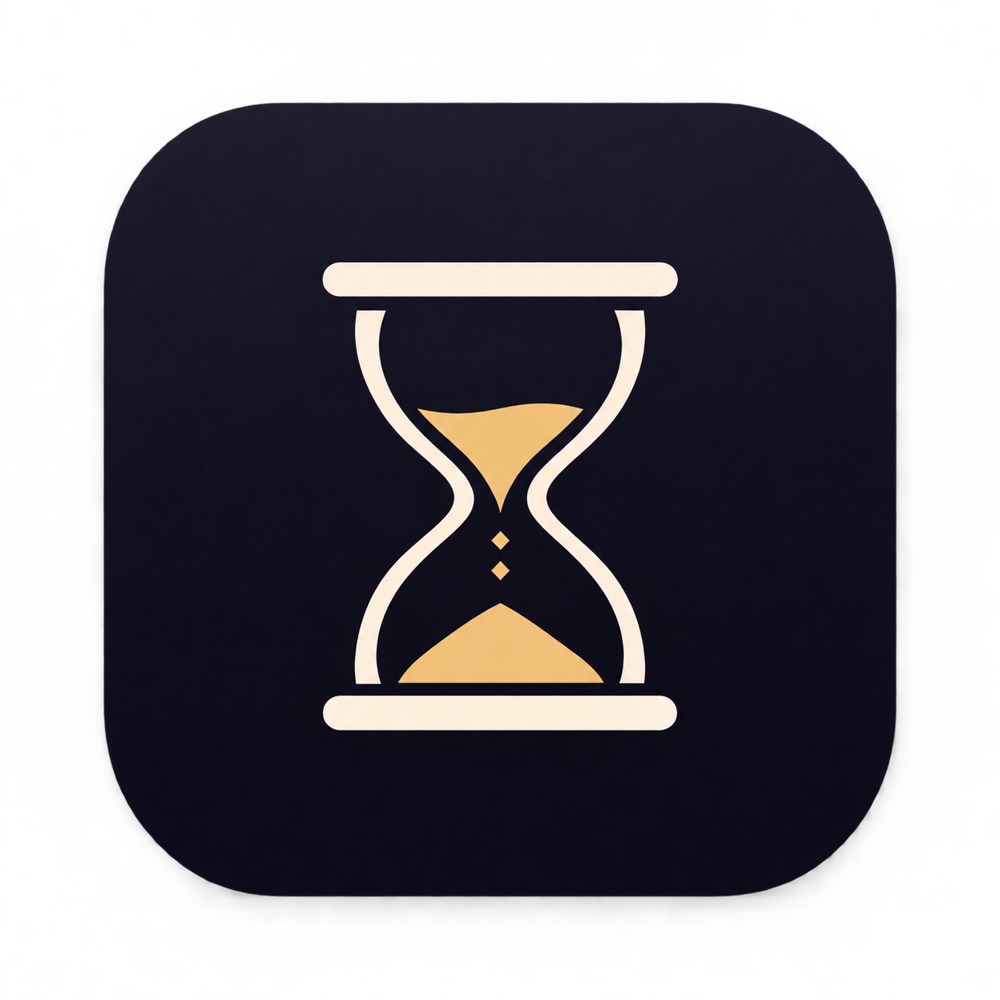

<p align="center">
  
</p>

<h1 align="center">Tabitos</h1>

<p align="center">
  Tarefas, hábitos e rotinas num só lugar.
</p>

<p align="center">
  
  
  
  
  
</p>

---

## O que faz

- **Hoje** — tarefas do dia e bons hábitos para marcar com um toque
- **Tarefas e listas** — prazos, recorrências, checklists e revisão do que ficou para trás
- **Hábitos** — bons hábitos para manter e maus hábitos para quebrar, com sequência e constância
- **Cronômetro** — tarefas e hábitos com tempo, que concluem sozinhos ao zerar
- **Calendário** — mês, semana e dia, com acompanhamentos por hábito
- **Lembretes** — avisos por tarefa ou hábito e um lembrete diário de revisão
- **Estatísticas** — resumo e histórico por semana, mês, ano ou tudo
- **Modo jogo** (opcional) — moedas, XP, níveis e recompensas pessoais

## Stack

Kotlin · Jetpack Compose + Material 3 · Hilt (KSP) · Room · DataStore · Coroutines/Flow · AGP 9

## Rodar localmente

Requisitos: Android Studio compatível com AGP 9, JDK 17+ e SDK 36.

```bash
git clone https://github.com/GabriellAfonso/tabitos-app.git
cd tabitos-app
./gradlew :app:assembleDebug        # Windows: .\gradlew.bat :app:assembleDebug
```

O APK sai em `app/build/outputs/apk/debug/app-debug.apk`. Roda em Android 7.0 (API 24) ou superior.

## Licença

Distribuído sob a [GNU GPL v3](LICENSE).
